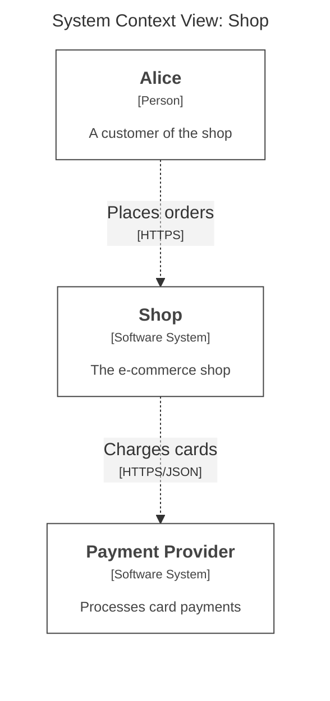
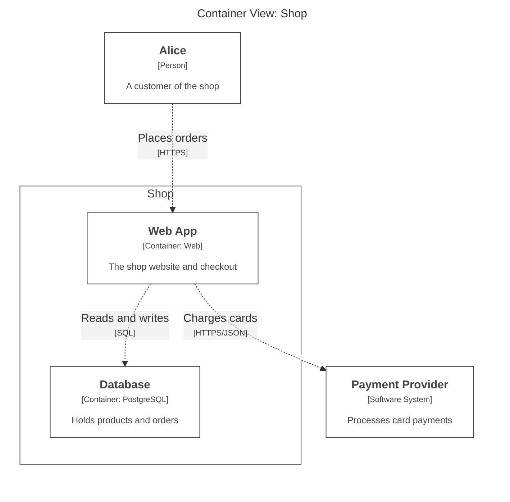
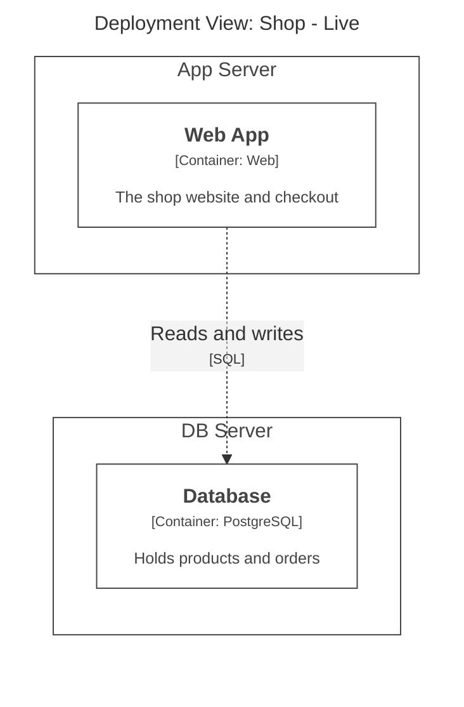
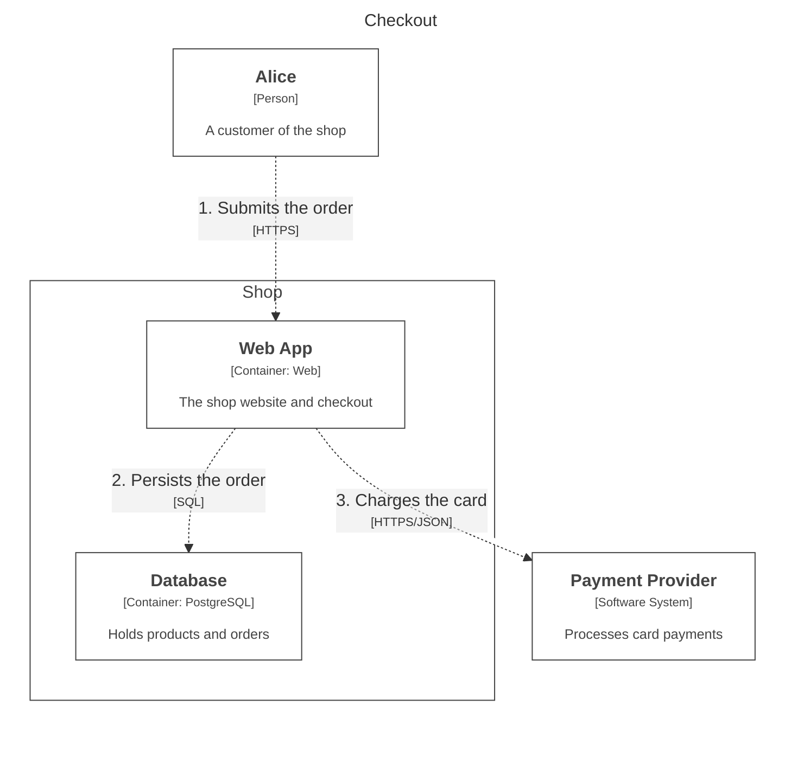
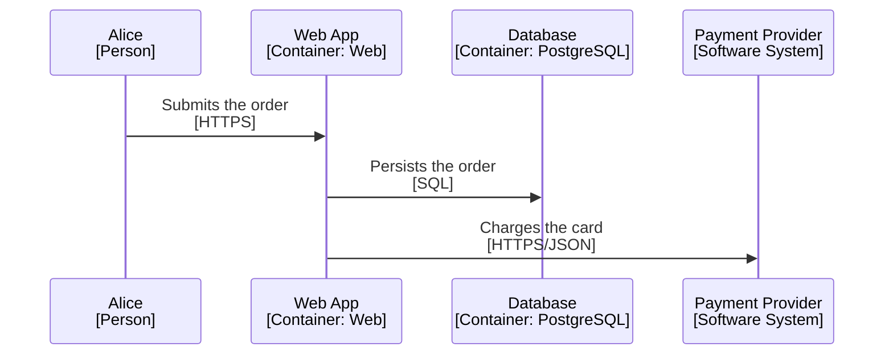

# Structurizr Mermaid export - rendering test

Every fenced block below is the **verbatim** output of
`docker run --rm -v /tmp/structurizr-spike:/usr/local/structurizr structurizr/structurizr:2026.10.26-noble export -w workspace.dsl -f mermaid -o out-mermaid`
(structurizr v2026.10.26, v2 DSL). No lines were changed.

**Render this file and report per section: renders correctly / renders but labels broken (HTML stripped) / syntax error, and copy the exact error text if any.**

Section 0 shows the renderer's Mermaid version (the word `info` is a built-in mermaid diagram).

## 0. Mermaid version probe

```mermaid
info
```
## 1. System Context View


## 2. Container View


## 3. Deployment View (Live)


## 4. Dynamic View: Checkout (collaboration, default)


## 5. Dynamic View: Checkout (sequence, mermaid.sequenceDiagram true)


