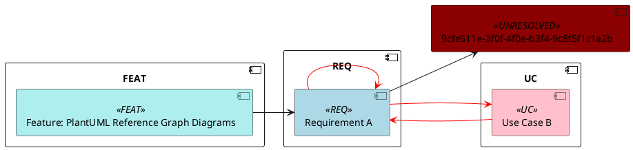

# Reference Graph Diagram Rulebook

The frozen mapping and validation spec for rendering specmgr's deterministic
cross-references (the 11-tag `<TYPE> <id>` reference vocabulary behind the
`list_references` tool, `general/tools/_references.py`) as a PlantUML component
diagram. This file is the content source of the `specmgr://reference-graph`
MCP resource and the single normative reference the pure renderer
(`general/models/reference_graph.py`), the graph builders
(`general/tools/_reference_graph.py`), the MCP tools
(`get_reference_diagram` / `get_reference_diagram_all`), and the CLI
(`specmgr diagram refs`) implement against. Provenance: FEAT feat-207-reference-graph (GitHub issue #207), Phase 100.

**Status: frozen.** A change to any rule below is a spec change — revise this
file and the feature plan, and (where it reverses a frozen decision) the ADR.
Never reinterpret a rule locally in a renderer, builder, checker, or CLI.

## 1. Overview

One node per artifact (label = the document title, truncated per §5), one
stereotype + colour per artifact type (the frozen 14-entry palette, §2.5),
nodes grouped into per-domain curly `component "TYPE" { … }` domain groups
(§2.7), one LABEL-FREE edge per unique reference (the referenced item
carries the incoming arrow, §2.8), every edge that lies on a cycle drawn
with a red arrow (§4), and every reference whose target cannot be resolved
on disk drawn as a top-level `<<UNRESOLVED>>` node (§2.6). Fully
deterministic: the same registry and the same arguments always emit
byte-identical PlantUML source.

Two entry surfaces, one frozen layout:

1. **Scoped diagram** (`get_reference_diagram(type, id, ...)` /
   `specmgr diagram refs <type> <id>`) — the requested source document, its
   outgoing reference neighbourhood to `depth` (default 1), optionally plus
   the direct incoming references to it (`reverse`), optionally minus the
   FEAT artifacts (`include_feat` / `--no-feat`, §3.5).
2. **Registry-wide diagram** (`get_reference_diagram_all` /
   `specmgr diagram refs all`) — every parseable document in the registry as
   a node, every extracted reference as an edge (§3.3).

Written artifacts are checker-clean by construction and carry no
structure-only header (UC rulebook §2.10 point 3).

## 2. Emission layout (frozen)

### 2.1 The shape

The renderer emits exactly this shape (one trailing newline; blank lines as
shown; `…` = repetition):

```plantuml
@startuml {title}

skinparam component {
  backgroundColor<<ADR>> LightYellow
  backgroundColor<<REQ>> LightBlue
  backgroundColor<<UC>> Pink
  backgroundColor<<TSK>> Honeydew
  backgroundColor<<QA>> LemonChiffon
  backgroundColor<<PRB>> LightCoral
  backgroundColor<<GOL>> Lavender
  backgroundColor<<RSK>> Orange
  backgroundColor<<DEC>> LightGreen
  backgroundColor<<SOP>> PowderBlue
  backgroundColor<<FEAT>> PaleTurquoise
  backgroundColor<<VCR>> Khaki
  backgroundColor<<SYSRS>> Thistle
  backgroundColor<<UNRESOLVED>> DarkRed
}

left to right direction

component "{id}" as [REQ-{uuid}] <<UNRESOLVED>>
(… one top-level line per unresolved node, sorted by alias …)

component "REQ" {
component "{label}" as [REQ-{uuid}] <<REQ>>
(… nodes sorted by id …)
}
(… one curly domain group per non-empty domain, in ALL_DOMAINS order …)

[REQ-{uuid}] --> [DEC-{uuid}]
[REQ-{uuid}] -[#red]-> [UC-{uuid}]
(… edges deduped + sorted by (source_type, source_id, target_type, target_id);
    label-free; the red form -[#red]-> only for on-cycle edges (§4) …)
@enduml
```

Section structure (the precise reading of "blank lines as shown"): the
content sections — the `@startuml {title}` line, the `skinparam component
{ … }` block, the `left to right direction` line, the top-level unresolved
node lines (one subgroup), one `component "TYPE" { … }` curly domain group
per non-empty domain (one subgroup each, in the 13-domain order), and the
edge section — are separated by exactly one blank line; an empty
subgroup/section is omitted entirely (it leaves no residual blank line);
`@enduml` always follows the last non-empty section directly (no blank line
before it). The source ends with exactly one trailing newline.

**§2.1 corrected 2026-10-11 (feat-207-reference-graph Phase 110):** the node
section's subgroups (the top-level unresolved lines, then one domain group
per non-empty domain) are separated by exactly one blank line, as §2.9's
worked example and the plan's emission schematic show; the earlier "no blank
line between consecutive packages" wording was a defect. The §2.9 byte
layout is the frozen one (the Phase 100 gate test's candidate subset, the
renderer, and the goldens all pin it).

**§2.1 corrected 2026-10-15 (feat-214-rel-invalid-diag Phase 100):** the
per-domain grouping is the curly-brace `component "TYPE" { … }` domain group
(above), replacing the former braceless `package "TYPE"` … `end package`
block — a real-parser syntax error over component declarations (the §4.3
verdict) — and the edges are label-free (the former uniform `: refers to`
label is gone, §2.8). The shape above is the frozen one (the §2.9 worked
example, the renderer, and the goldens all pin it).

### 2.2 Title

- The `title` override argument when given; otherwise the source document's
  H1 (scoped) or `Reference Graph` (registry-wide).
- Sanitised per §5.1 (single-line, `#quot;`) and **never truncated** — even
  when the scoped H1 is longer than the §5.2 truncation limit (a >40-char-H1
  golden pins this, ACC-001).

**§2.2 note 2026-10-12 (feat-207-reference-graph review pass 3, I2):** the
frozen sanitisation (§5.1) does not strip whitespace, so a degenerate `title`
override emits verbatim after the `@startuml {title}` layout's own one
space: an empty `title` (`""`) renders the diagram's first line as
`@startuml ` — `@startuml` + exactly one trailing space — and a
whitespace-only `title` renders `@startuml` + the layout's space + the
whitespace verbatim (e.g. `" "` ⇒ `@startuml  ` — two trailing spaces).
Both outcomes are valid PlantUML and checker-clean (zero findings in both
modes); the corner is pinned by renderer tests
(`tests/general/models/test_reference_graph.py`). The frozen
sanitize-but-never-truncate algorithm is unchanged.

### 2.3 Alias (bracketed)

- The 12 UUID domains (every domain except `feat` —
  `general/tools/_domains.py`'s `UUID_DOMAINS`): `[TYPE-{uuid}]` — the
  UPPERCASE type tag, the verbatim lowercase uuid (e.g.
  `[REQ-1a2b3c4d-5e6f-4a5b-8c9d-0e1f2a3b4c5d]`).
- `feat`: the verbatim `feat-NNN-slug` id — already type-prefixed and
  registry-unique (e.g. `[feat-207-reference-graph]`).
- The alias is unique per (type, id) key ⇒ collision-free. Edge operands are
  the bracketed alias verbatim (§2.8).

### 2.4 Label

- A resolved node: its H1, sanitised and truncated per §5.
- An unresolved node: the verbatim id (uuid or feat id — full `feat-NNN-slug`
  or bare `feat-NNN`), never truncated.
- Labels are always emitted in double quotes; the structural quotes are added
  after sanitisation and remain real `"` (UC rulebook §2.4).

**§2.4 corrected 2026-10-12 (feat-207-reference-graph review fixes):** a
resolved FEAT node's label is its H1 WITH the `Feature: ` prefix stripped
(the `feature_title` derivation, the §3.1 "node title via the reference
resolution") before the §5 sanitisation + truncation — the first bullet's
unstripped "its H1" reading is the non-FEAT one. The §2.9 worked example's
FEAT label (`"Feature: PlantUML Reference Graph Diagrams"`) is the
hand-built renderer anchor's verbatim text (see the §2.9 note below), not
builder output.

### 2.5 Palette (the frozen 14-entry skinparam block)

The `skinparam component { … }` block of §2.1, verbatim — always emitted in
FULL (all 14 entries, in the block's order: ADR, REQ, UC, TSK, QA, PRB, GOL,
RSK, DEC, SOP, FEAT, VCR, SYSRS, UNRESOLVED) regardless of which types
appear in the diagram.

### 2.6 Unresolved nodes

A reference whose target cannot be resolved on disk is drawn as a top-level
`component "{id}" as [TYPE-{id}] <<UNRESOLVED>>` node — outside any package,
sorted by alias (the bracketed alias's text, lexicographic), BEFORE the first
package. For the UUID domains the label is the verbatim uuid and the alias `[TYPE-{uuid}]`; for feat the label is the verbatim feat id and the alias the same id unbracketed-and-verbatim (e.g. `component "feat-207" as [feat-207] <<UNRESOLVED>>`).

### 2.7 Domain groups (curly)

One `component "{TYPE}" { … }` curly domain group per NON-EMPTY domain (a
domain with no node emits no group), in `ALL_DOMAINS` order (adr, req, uc,
tsk, qa, prb, gol, rsk, dec, sop, feat, vcr, sysrs); the group title is the
UPPERCASE type tag. The group is a `component` declaration line ending with
`{`, closed by the `}` line. Nodes are sorted by id (the verbatim id string,
lexicographic) inside a group.

**§2.7 corrected 2026-10-15 (feat-214-rel-invalid-diag Phase 100):** the
grouping form is the curly-brace domain group above, replacing the former
`package "{TYPE}"` … `end package` block (this section's pre-correction
text). The replacement is parser-verified, not stylistic: the real
PlantUML 1.2026.8 parser rejects a component declaration inside a `package`
block — EVERY braceless `package NAME … end package` form over component
declarations fails (bare `component Foo`, quoted component, with/without
alias, and the short `[Foo]` form), and a curly-open `package "NAME" {`
closed with a named `end package` fails too (the §4.3 isolation matrix);
the curly-brace `component "TYPE" { … }` group is the accepted form (the
issue's own diagnosis: a component grouping must use curly braces). The
structure checker gains a matching tripwire (a `package` fragment
collecting component declarations must close with `}` — §7.1), so the
false-negative class that let the old layout ship cannot re-enter through
the checker-only path.

### 2.8 Edges (label-free)

- One edge per UNIQUE reference: `{src-alias} --> {dst-alias}` — the
  referenced item carries the incoming arrow; the edge is LABEL-FREE (no
  `: refers to` or any other label — per-type edge labels were always out
  of scope, and the former uniform label was never intentionally approved).
- Edges are deduped (one edge per (source, target) pair) and sorted by the
  tuple (source_type, source_id, target_type, target_id) — the type is the
  LOWERCASE domain name, the id the verbatim id string, lexicographic
  tuple order.
- An on-cycle edge (§4) renders the red form `{src-alias} -[#red]->
  {dst-alias}`; every off-cycle edge renders plain `-->`. Both forms are
  label-free.

**§2.8 corrected 2026-10-15 (feat-214-rel-invalid-diag Phase 100):** the
edges are label-free, removing the former uniform `: refers to` label
(planning-session ruling for issue #214 — the label was never intentionally
approved; the requested form is a plain arrow connector from source to
destination). Parser-verified: the label-free forms exit 0 in the real
1.2026.8 parser and carry ZERO structure-checker findings in both modes
(the edge operands are declared bracketed aliases, so the association
branch emits no undeclared-node warning; the `-[#red]->` form is outside
the checker's frozen line grammar and silently accepted, as before).

### 2.9 Worked example (frozen)

The scoped diagram for a REQ node `Requirement A`
(`1a2b3c4d-5e6f-4a5b-8c9d-0e1f2a3b4c5d`) that references a UC node
`Use Case B` (`6f7e8d9c-5b4a-4f3e-8d7c-6b5a4f3e2d1c`, which references it
back — a 2-cycle, both edges red) and a DEC id that does not exist on disk
(unresolved), plus a self-reference of the REQ (red self-loop) and a FEAT
document referencing the REQ:



This exact source is the candidate emission subset the Phase 100
real-parser gate (§4.3) verifies, and it must pass the amended structure
checker in both modes with ZERO findings (ACC-002).

**§2.9 note 2026-10-12 (feat-207-reference-graph review fixes):** the
worked example is the `max_label=42` rendering of its own fact collection —
its 42-character FEAT label is the §5.2 exactly-N no-op case, and at the
default 40 that label would truncate (the renderer unit test,
`tests/general/models/test_reference_graph.py`, renders the anchor at 42
for byte-identity).

**§2.9 regenerated 2026-10-15 (feat-214-rel-invalid-diag Phase 100):** the
worked example is re-rendered BYTE-EXACT from the corrected layout (the
§2.7 curly domain groups, the §2.8 label-free edges — same fact
collection, same `max_label=42`). This text is the 2026-10-15 §4.3
real-parser verdict's passing artifact and the Phase 100 gate test's
`_EMITTED_SUBSET` verbatim (the rulebook↔gate drift pin).

### 2.10 File layout (CLI)

`specmgr diagram refs` writes, CWD-relative under `--out` (default
`diagrams/refs/`): `<out>/<id>.refs.puml` (scoped) and
`<out>/reference-graph.puml` (registry-wide). Written artifacts are
deterministic (no timestamp, no structure-only header), git-tracked, and
CLI-regenerable; `--check` regenerates in memory and byte-diffs without
writing (UC rulebook §2.10 point 2). `specmgr plantuml-check` /
`plantuml-encode` work on the files unchanged.

## 3. Graph construction (frozen)

### 3.1 Scoped forward (BFS)

Level 0 = the source. A level-k node is expanded only if k < depth and it
resolved to an existing document (its body read through the domain's read
path — the cache-aware leg for the 12 whole-body domains, the never-cached
leg for adr, ADR bfd76370). Each unique (type, id) reference adds exactly
one edge + one node (the node title via the reference resolution; a dangling
target = no title = the unresolved node of §2.6). `depth` is validated 1..5
(default 1); a malformed value is a `ValueError` before any filesystem
access.

### 3.2 Reverse (additive, direct-only)

A full scan of all 13 source domains (`ALL_DOMAINS` — adr included),
iterating each domain's own path iterator directly — no listing, no
pagination — reusing the `list_references` source-scan legs (the per-domain
cache-aware reads; the never-cached adr leg). A scanned document becomes a
node + one incoming edge iff it carries a reference matching the source on
(type, id) — with the feat dual-spelling rule: a full `feat-NNN-slug` source
also matches a bare `feat-NNN` reference. Reverse is ADDITIVE with the
forward expansion (the graph is the union) and DIRECT-ONLY on the incoming
side (no transitive incoming expansion — out of scope); `depth` governs the
forward part only and is never a no-op.

**§3.2 corrected 2026-10-12 (feat-207-reference-graph review pass 3, D1):**
the scan iterates each domain's own path iterator directly (no listing, no
pagination); the earlier "A paged full scan (all pages)" wording named a
paged-listing mechanism the implementation does not use. The outcome is
equivalent — every parseable document of all 13 domains is seen, broken and
id-less documents skipped — so the frozen construction semantics are
unchanged.

### 3.3 Registry-wide

The same 13-domain scan: every successfully-parsed document is a node — a
document whose frontmatter `id` is `None` is skipped (it carries no
`(type, id)` graph key; reachable today only for hand-authored id-less
ADRs); every extracted reference is an edge; a target not present as a
scanned document gets its title via the reference resolution (dangling ⇒
the unresolved node of §2.6).

### 3.4 Broken documents

Broken documents in any scan are skipped (never a node, never an edge
source; the render never fails — the `get_use_case_package_diagram`
precedent). A broken *source* of a scoped call is a tool-level
`ParseFailureResult` (the builder raises the domain's parse error; the tool
converts — the feat-150 precedent). A missing source raises the source
domain's not-found error.

### 3.5 FEAT exclusion (ONE rule)

`include_feat=False` (CLI `--no-feat`) is applied LAST, after the full graph
is built, in ALL modes: drop every FEAT node except the explicitly requested
source, then drop every edge touching a dropped node. A feat target must not
surface as a node or an edge in any mode — the post-hoc drop is the
definition; omitting the feat-domain scan is an allowed optimization only if
it ALSO suppresses feat-targeted references.

### 3.6 Cycle safety

Every build runs over a visited (type, id) set — reference cycles terminate
by construction; they affect only rendering (§4).

### 3.7 Inherited caveats (documented, not fixed)

The extractor scans fenced code blocks (a quoted reference becomes an edge,
usually a dangling one — the accepted v1 tradeoff pinned by
feat-144-ref-artifact), and the feat dual spellings (full `feat-NNN-slug`
and bare `feat-NNN`) are two DISTINCT nodes (parity with the pinned
`list_references` rows).

## 4. Cycle detection + red arrows (frozen)

### 4.1 Characterization

An edge lies on a cycle iff it is a self-loop (source == target) or both
endpoints belong to the same strongly connected component (SCC) of size ≥ 2.
Exact characterization: within an SCC every pair of nodes is mutually
reachable, so any internal edge (u→v) plus a v→…→u path forms a cycle
containing it; conversely, every node on a cycle is mutually reachable with
the rest of it, so a cycle's nodes form (a subset of) one SCC.

### 4.2 Computation

Iterative Tarjan (stdlib, deterministic node order) inside the renderer —
the model stays pure facts.

### 4.3 Red-arrow syntax + real-parser gate verdict

On-cycle edges render `{src-alias} -[#red]-> {dst-alias}` (label-free, §2.8
— the red-arrow syntax `-[#red]->` is the frozen form). The gate is the
env-gated test(s) that run where a `SPECMGR_PLANTUML_*` source is
configured (the `tests/conftest.py` `plantuml_source()` machinery) and skip
cleanly where none is — verifying the full emission subset (§2.9:
`component "…" as [alias] <<ST>>` declarations, the 14-entry skinparam
colour block, label-free `-->` / red-arrow edges, self-loops, the curly
`component "TYPE" { … }` domain groups, top-level unresolved nodes)
end-to-end through the real parser (parse + render), and — since
feat-214 Phase 100 — the env-gated golden parser sweep over EVERY
committed reference-graph golden (`tests/fixtures/reference-graphs/
goldens/`): parser verification of the whole frozen set, not just the one
synthetic subset.

**Verdict, 2026-10-15 (feat-214-rel-invalid-diag Phase 100 — replacing the
2026-10-10 skip verdict):** VERIFIED against the pinned PlantUML 1.2026.8
release jar (the 149874a build; pinned URL
`https://github.com/plantuml/plantuml/releases/download/v1.2026.8/plantuml-1.2026.8.jar`,
SHA-256 `5e1ecfa8ecd32c90b03bbf3b1eb6f020943f98ab0fcf4032be31a0002ee2c462`,
verified before use) — (a) the PRE-CORRECTION frozen layout FAILS: the
former §2.9 worked example answers `ERROR 25 — Syntax Error? (Assumed
diagram type: component)` (line 25 the first component declaration inside
the braceless `package "REQ"` block), and EVERY braceless
`package NAME … end package` form over component declarations fails the
same way (bare `component Foo`, quoted component, with/without alias, the
short `[Foo]` form), as does a curly-open `package "NAME" {` closed with a
named `end package`; over four CURRENT real-registry emissions
(registry-wide `include_feat=False` + scoped `reverse=True` over feat,
req, and sysrs sources) the same syntax error lands on a component line
inside the first braceless `package` block of each. (b) the CORRECTED
layout PASSES: the regenerated §2.9 worked example (curly domain groups +
label-free edges) exits 0 through the pinned jar and renders a real SVG
carrying the palette fills (Pink `#FFC0CB`, PaleTurquoise `#AFEEEE`,
LightBlue `#ADD8E6`, DarkRed `#8B0000`), the node titles, and the red
`#F00` arrows; the four mechanically-transformed real-registry emissions
(the same fix applied to the pre-correction sources) exit 0 with the same
render proof. The `-[#red]->` form is the frozen red-arrow syntax on this
verdict, and the label-free edge forms are frozen with it. A
`-[#red]->`-shaped line is outside the checker's frozen line grammar and
is silently accepted by the structure checker (verified by trace; ACC-002
pins the zero-finding property over the full subset in both modes).
**Convention (replacing the skip verdict's "re-verify where a source is
configured"): an emission layout is NOT frozen on a skipped gate** — the
2026-10-10 ship happened exactly that way (the gate skipped, the
parser-INVALID layout shipped), and the CI real-parser job (feat-214
Phase 120) makes the skip impossible on the commit path. Where a source IS
configured, the gate's env-gated tests re-verify the subset and every
golden before this rulebook's forms may be changed.

**§4.3 amended 2026-10-15 (feat-214-rel-invalid-diag Phase 120) — the gate
now RUNS in CI:** the `plantuml-parser` job in `.github/workflows/ci.yml`
(single pinned Python 3.13.13, mirroring the `build` job's docs-drift pin)
runs on every push to `main`/`dev` and on every PR: it downloads the
pinned jar (URL + SHA-256 above), hash-verifies it in its own step BEFORE
any use (the job fails on mismatch), exports `SPECMGR_PLANTUML_JAR`, and
runs the FULL suite with `uv run --frozen pytest -n auto -rs` — so the
env-gated real-parser tests (this subset gate, the golden parser sweep,
and every other `require_plantuml_source`-gated test) execute and PASS on
the commit path instead of skipping (ACC-005: the `-rs` short summary
carries no `require_plantuml_source` skip reason; the only legitimate
skips are the live URL-matrix tests, which apply only to a selected URL
source), making the 2026-10-10 "skipped — re-verify where a source is
configured" outcome structurally impossible there. The gates remain
env-gated off the commit path: where no `SPECMGR_PLANTUML_*` source is
configured they skip cleanly (reported via `pytest -rs`), and the
documented local-dev flow is the gitignored repo-root `.env` (loaded by
`tests/conftest.py` at collection — e.g.
`SPECMGR_PLANTUML_JAR=/home/user/plantuml.jar` on the authoring machine),
which runs the identical gates locally with zero repo changes.

## 5. Sanitisation and truncation (frozen)

### 5.1 Sanitisation (UC rulebook §2.4, reused as-is)

- **Quote sanitisation:** an embedded `"` in any emitted content (title,
  label, edge label) is emitted as the PlantUML escape `#quot;`. The
  structural double quotes PlantUML requires around a component label are
  added *after* sanitisation and remain real `"`.
- **Single-line:** the title is emitted on exactly one `@startuml` line; a
  literal newline in the title text is emitted as the two-character
  sequence `\n` (UC rulebook §2.4 single-line escape).

### 5.2 Label truncation (`SPECMGR_DIAGRAM_MAX_TITLE`)

- `SPECMGR_DIAGRAM_MAX_TITLE` — an int, default 40, read by the shared
  helper `general/tools/_diagram_config.py` (Phase 110). A set-but-invalid
  value (empty, non-int, or < 1) falls back to 40 (with a validity flag
  surfaced by `specmgr://config`).
- Applies to the resolved-node H1 labels ONLY — the `@startuml` diagram
  title is sanitised but never truncated (§2.2), and unresolved ids stay
  verbatim (§2.4).
- Algorithm (N = the effective limit, label = the sanitised H1): if
  `len(label) > N`: `candidate = label[:N-1]`; if `candidate` contains a
  space, cut at its LAST space (dropping from that space on); else hard cut
  at `candidate`; append `…`. The result is ≤ N characters. Labels of
  exactly N characters are untouched.

**§5.2 note 2026-10-12 (feat-207-reference-graph review fixes):** the env
var's parse is Python `int()` (the helper's own `int(value)` call) — it
accepts surrounding whitespace, a leading sign, and underscored digit
groups, so values such as `" 10 "` and `"1_0"` are VALID limits
(`(10, True)`), not set-but-invalid (the `< 1` range check still applies
after the parse, so a negative value such as `"-5"` stays set-but-invalid);
the helper's pinned invalid set stops at the non-int cases (`"3.5"`,
`"0x28"`).

**§5.2 note 2026-10-12 (feat-207-reference-graph review fixes):** the §5.1
sanitisation (an embedded `"` → the six-character sequence `#quot;`) runs
BEFORE the truncation, so a hard cut (no space within `label[:N-1]`) can
land INSIDE a `#quot;` escape — emitting an incomplete escape fragment plus
`…` (at the default 40, a 56-character space-less title whose `"` sits at
index 35 truncates to its first 35 characters + `#quo` + `…`). The output
stays syntactically valid (checker-clean); the degradation is cosmetic
only. The frozen algorithm is implemented as-is (not amended); the corner
is pinned by a renderer test
(`tests/general/models/test_reference_graph.py`).

## 6. Source-id addressing

The scoped surface's `id` argument takes the domain's own id shape (the canonical lowercase-hex uuid for every domain other than `feat`; the full `feat-NNN-slug` for `feat`) — the `validate_id` strictness: a `ValueError` before any filesystem access. **A bare `feat-NNN` as the source id is REJECTED** — a wrong-format id, not a normalization candidate (`get_feat` / `list_references` parity; the bare spelling appears only as an extracted reference row, never as an addressing form). To discover the exact `feat-NNN-slug` id, call `list_feat` (its rows carry id + title + path).

## 7. Validation (reused as-is from the UC rulebook)

The emitted diagram is validated by the SAME strict chain and the SAME
two-mode structure checker as the UC diagrams — `specmgr://uc/plantuml`
§3–§6 applies to the reference-graph emission verbatim: the strict
first-set-wins 3-source chain over `SPECMGR_PLANTUML_JAR` /
`SPECMGR_PLANTUML_BIN` / `SPECMGR_PLANTUML_URL` (§3), the jar/bin and URL
invocation contracts (§4–§5), the §5.2 classification matrix, and the
§6.1–§6.5 checker contract (modes, the verified lenient set, the never
reject what the parser accepts rule). No reference-graph-specific
validation source, backend, or checker mode is introduced.

### 7.1 Structure-checker amendment (2026-10-10, this feature)

The emitted subset extends the checker's frozen declaration grammar in
`plantuml/structure.py` (the dated note lives in the UC rulebook §6.1,
which cites this feature): (a) the declaration keyword set gains
`component`; (b) the `as` alias grammar (the frozen declaration shapes and
the legacy walk) also accepts a bracketed token
`[<no whitespace, no brackets>]`, recorded in the declared set
UNBRACKETED; (c) the edge-operand unwrap (`_strip_operand`) also unwraps a
fully-bracketed token, so declaration and edge operands compare
identically. `-[#red]->`-shaped lines and `skinparam` lines are outside
the checker's frozen line grammar and are silently accepted (verified by
trace, pinned by ACC-002's zero-finding assertion over the full subset in
both modes); the named `end package` close is already accepted (a bare
`end` on a `package` fragment is a hard error in both modes — which is why
§2.7 closed the former packages with the named form). The existing UC
subset + goldens stay byte-identical (regression-pinned by the existing
goldens; ACC-002).

**§7.1 tripwire amendment + checker-contract restatement (2026-10-15,
feat-214-rel-invalid-diag):** (a) TRIPWIRE — the demonstrated
false-negative class becomes a verified true-positive rule: a `package`
fragment that COLLECTS component declarations (a `component` keyword
declaration line or a short-form `[X]` line — a line of exactly one
bracketed token) must close with a `}` line; a named `end package` close
(after a braceless-open or a curly-open) and an unclosed such fragment at
a block boundary (an `@enduml`, a next `@startuml`, or a true EOF) are
errors in BOTH modes, with a fix hint naming the curly-brace group form
(`component "TYPE" { … }`). The rule is content-conditional: `package`
fragments holding sequence content (participants — the UC subset,
parser-verified in feat-185) collect no component declaration and stay
exactly as before (the UC goldens stay byte-identical, zero-finding in
both modes; the matching dated note lives in the UC rulebook §6.1). The
pre-amendment checker reported zero findings in both modes over the
parser-rejected braceless `package` grouping: the "never reject what the
parser accepts" invariant forbids false positives, not false negatives,
and the real parser is the sole validity authority (the 2026-10-15 §4.3
verdict). (b) CHECKER CONTRACT, RESTATEATED — a `valid=True` verdict is a
PARSER verdict only when `checked_by != structure`: the structure-only
outcome (the all-unset `SPECMGR_PLANTUML_*` floor and every pre-flight
short-circuit) means "plausible / marker-clean", never "valid". The
checker keeps every load-bearing role: the sourceless validation floor
(incl. the deliberate sourceless pre-commit `SPECMGR_TESTS_NO_DOTENV`
re-run), actionable line/cause/fix-hint diagnostics, UNATTRIBUTED-marker
detection (comments the parser cannot see), millisecond speed without a
JVM, and the pre-flight short-circuit that never invokes the parser on a
structure red.

## 8. References

- Feature plan (requirements, acceptance criteria, phase task list): `.specmgr/feat/feat-207-reference-graph/README.md` — FEAT feat-207-reference-graph (GitHub issue #207).
- UC rulebook (the reused validation chain + the amended checker):
  `specmgr://uc/plantuml` (`src/biz/dfch/specmgr/uc/data/uc_plantuml.md`)
  — FEAT feat-185-uc-diagrams (GitHub issue #185).
- The shared reference-tag vocabulary + `ReferenceRow` + the
  `list_references` guard contract: `src/biz/dfch/specmgr/general/tools/_references.py`
  — FEAT feat-144-ref-artifact (GitHub issue #144); the `FEAT` tag's dual
  id shape — FEAT feat-177-list-ref-feat.
- `plantuml/` package placement + strict chain policy: ADR 7a626b12-b189-4561-a51d-ffb2e9e193b4.
- The DocCache adr exclusion (the never-cached adr leg of §3): ADR bfd76370-b59b-4d65-b550-a969f6c93c9d.
- Non-raising structured-result precedent (the §3.4 broken-source `ParseFailureResult` is case 3 of the chain): ADR 519d1206-4d2a-4500-9046-6db635209996 and its extensions ADR b399f1ce-ed42-4929-b01c-7a57d18e8014, ADR 9080b37c-82b3-4f63-81f1-79641d0bf14c, ADR b8c9bfea-6dcf-4158-bfc5-4ec17abb842f.
