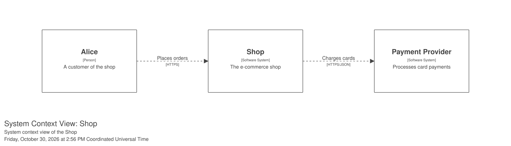
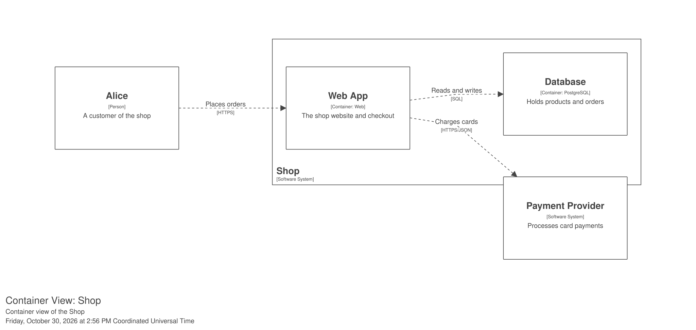
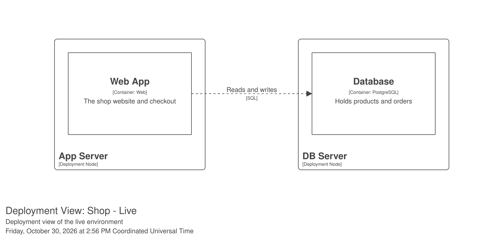

# Structurizr SVG export - rendering test

Each section below embeds one **pre-rendered SVG** (exported headlessly by the
`structurizr/structurizr:2026.10.26-playwright` image, see out-svg/) as a
markdown image. Report per section: renders / broken, and any exact error text.

## 1. System Context View

## 2. Container View

## 3. Deployment View (Live)

## 4. Dynamic View: Checkout (collaboration)

